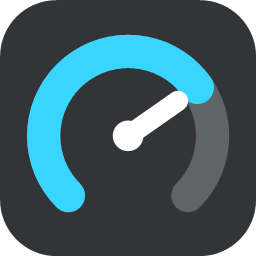
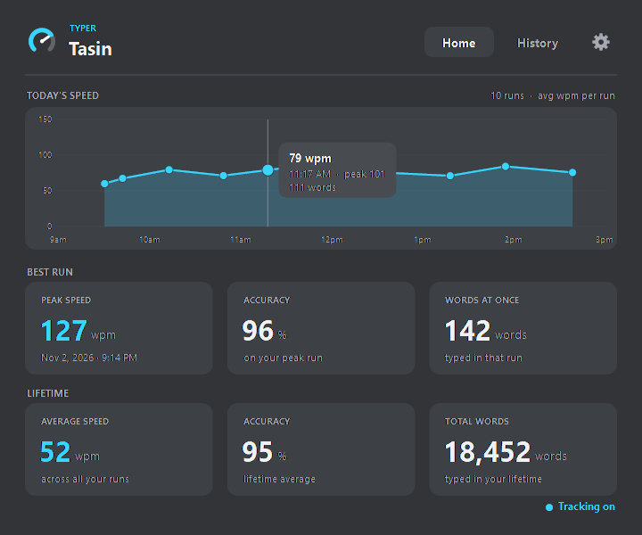
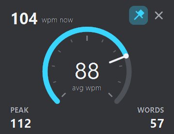
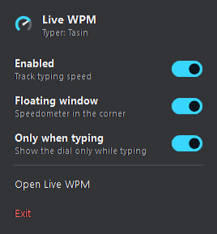
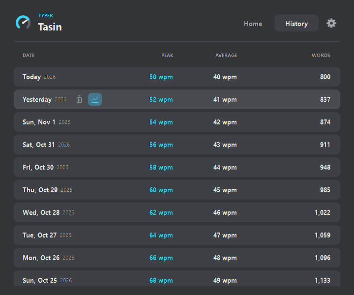
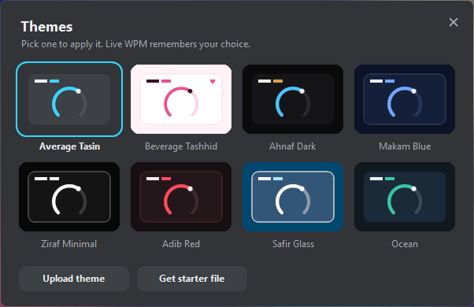
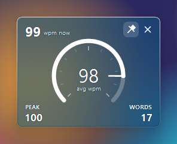

<p align="center">
  
</p>

<h1 align="center">Live WPM</h1>

<p align="center">
  <b>A live typing speedometer for Windows.</b><br>
  See how fast you type while you type: in any app, with no setup, and without recording a single key.
</p>

<p align="center">
  
  
  
  
  
</p>

<p align="center">
  <a href="https://github.com/tasin-py/Live-WPM/releases/latest"><b>Download</b></a> ·
  <a href="#whats-new">What's new</a> ·
  <a href="#features">Features</a> ·
  <a href="#privacy">Privacy</a> ·
  <a href="#using-live-wpm">Guide</a> ·
  <a href="#faq">FAQ</a> ·
  <a href="#building-from-source">Build</a>
</p>

<p align="center">
  
</p>

---

## Contents

- [What's new](#whats-new)
- [Features](#features)
- [Privacy](#privacy)
- [Requirements](#requirements)
- [Installation](#installation)
- [Using Live WPM](#using-live-wpm)
  - [The tray icon](#the-tray-icon)
  - [The floating speedometer](#the-floating-speedometer)
  - [Home](#home)
  - [History](#history)
  - [Settings](#settings)
  - [Themes](#themes)
- [How speed is measured](#how-speed-is-measured)
- [Updates](#updates)
- [Your data](#your-data)
- [Uninstalling](#uninstalling)
- [FAQ](#faq)
- [Building from source](#building-from-source)
- [Publishing a release](#publishing-a-release)
- [Project structure](#project-structure)
- [Support](#support)

---

## What's new

**1.6** (current: 1.6.0)

- **Your own themes**: upload a small theme file from the theme picker and it joins the built-in themes. See [Make your own theme](#make-your-own-theme).

**1.5**

- **Seven themes**: Average Tasin, Beverage Tashhid, Ahnaf Dark, Makam Blue, Ziraf Minimal, Adib Red and Safir Glass. Each one restyles the main window and the floating speedometer.
- **Safir Glass**: the speedometer shows your blurred desktop through a deep sky-blue tint, and the main window matches it in deep navy, with raised 3D panes.
- **Floating window background slider**: fade the speedometer's background from solid to fully clear, with the numbers and dial staying sharp.
- **Remove last session**: take back your most recent run, peak speed included.
- **Cleaner Settings**: three simple groups (General, Data, About), one line per setting.
- **More reliable typing detection**: the keyboard hook re-attaches itself, and full-screen detection no longer mistakes a maximised browser or editor for a game.
- **Smoother speedometer**: true rounded corners, no line through the middle, and bolder corner labels in the light themes.
- **Sharper Safir Glass text**: glass now uses the same ClearType text as the other themes, so it stays crisp over any desktop.
- **Your theme is remembered**: Live WPM opens in the theme you last picked.
- **Updates now on**: the app checks this repository's releases once a day.

---

## Features

| | |
|---|---|
| **Live speedometer** | A small dial floats over your screen and shows your speed as you type, in any app. |
| **Shows up only when you type** | The dial fades in when you start typing and fades out about 4 seconds after you stop. |
| **Best-run records** | Keeps your peak speed, along with the accuracy and word count of that run. |
| **Daily graphs** | Every typing run is plotted across the day, so you can see when you type fastest. |
| **Themes** | Seven built-in looks, from flat dark grey to pink, black-and-gold, all-white-on-black and see-through glass, plus up to nine of your own. |
| **History** | One row per day with peak speed, average speed and word count. You can delete any day. |
| **Ignores games** | Key presses are skipped while a full-screen app is in front, and runs full of held-down keys are thrown out. |
| **Ignores shortcuts** | Ctrl, Alt and Win shortcuts and key auto-repeat are never counted. |
| **One switch to stop** | Turn tracking off from the tray and the app ignores your keyboard completely. |
| **Light** | One ~135 KB exe. No installer, no runtime to download, and next to no CPU while idle. |
| **Sharp on any display** | Per-monitor DPI support keeps text crisp at 100%, 150%, 200% and on mixed-scale setups. |
| **Undo a run** | Remove the last session, and the peak it set goes back to what it was before. |
| **Self-updating** | Checks once a day for a new version and updates when you say so. |

<p align="center">
  
  &nbsp;&nbsp;
  
</p>

---

## Privacy

Live WPM is built so that it **cannot** tell anyone what you typed, including you.

**What it keeps:** only numbers. These are speeds, accuracy, word and character counts, backspace counts, durations, and the time of day each run started.

**What it never keeps:** the keys themselves. When a key is pressed, the app sorts it into one of four kinds (a character, a space or Enter, a backspace, or a held key) and discards it right away. Which letter you pressed is never stored, in memory or on disk. Passwords, messages and documents are never seen as text.

**Network:** the app connects to the internet for one thing only: a once-a-day check of this project's GitHub Releases for a new version, plus the download when you choose to update. No statistics, analytics or telemetry are ever sent.

**Off means off:** when tracking is switched off, the app stops reacting to the keyboard entirely.

> [!NOTE]
> Everything is stored in a single plain-text file on your own PC (see [Your data](#your-data)). You can open it in Notepad and check that it contains only numbers.

---

## Requirements

- Windows 10 or Windows 11 (64-bit or 32-bit)
- .NET Framework 4.x, which is already part of every Windows 10 and 11 install

---

## Installation

1. Download **`Live WPM.exe`** from the [latest release](https://github.com/tasin-py/Live-WPM/releases/latest).
2. Move it to a folder you'll keep, for example `C:\Users\<you>\Apps\Live WPM\`.
   Start with Windows remembers this location, so don't run it from your Downloads folder if you plan to clean that out.
3. Double-click it.
4. If Windows shows **"Windows protected your PC"**, click **More info → Run anyway**.
   This appears for apps from smaller publishers that aren't code-signed. See the [FAQ](#faq).
5. Enter a name when asked. It's only shown in the app, as your *Typer* name.

Live WPM now runs in the system tray, next to the clock. Start typing anywhere and the speedometer appears.

> [!TIP]
> If you don't see the icon, click the **^** arrow in the taskbar's notification area. You can drag the icon out of there to keep it always visible.

---

## Using Live WPM

### The tray icon

| Action | Result |
|---|---|
| **Click** (left or right) | Opens the quick menu |
| **Double-click** | Opens the main Live WPM window |

The quick menu has three switches:

- **Enabled:** turns tracking on or off. When it's off, the tray icon turns grey and no keys are seen.
- **Floating window:** shows or hides the speedometer.
- **Only when typing:** shows the speedometer only while you type, instead of all the time.

Below them are **Open Live WPM** and **Exit**.

### The floating speedometer

| Part | Meaning |
|---|---|
| **wpm now** (top left) | Your speed right now, from your last 3 seconds of typing. It drops to 0 as soon as you pause. |
| **Dial and centre number** | Your average speed for the current run. |
| **PEAK** | The highest live speed reached in this run. |
| **WORDS** | Words typed in this run. |

The dial's range is set by your all-time peak, so a full dial means you're typing at your record speed.

- The arc turns **red** as you approach your record.
- The centre number turns **orange** when you're on pace to **beat** your record.

Controls:

- **Drag** anywhere on the dial to move it. Its position is remembered.
- **Pin** (top right) keeps it above other windows. Unpin it to let other windows cover it.
- **✕** hides the speedometer. Turn it back on from the tray menu's **Floating window** switch.

### Home

- **Today's speed:** a graph of every typing run today. Each point is one run's average speed. Hover a point to see its time, peak and word count.
- **Best run:** your peak speed, with that run's accuracy and word count.
- **Lifetime:** your average speed, average accuracy and total words.

### History

One row per day, newest first, with that day's **peak**, **average** and **words**. Hover a row to see two buttons:

- the **graph** icon opens that day's speed graph
- the **trash** icon deletes that day

<p align="center">
  
</p>

### Settings

Settings is split into three groups.

**General**

| Setting | What it does |
|---|---|
| **Typer Name** | Change the name shown in the app. |
| **Start with Windows** | Starts Live WPM quietly in the tray when you sign in. It appears in Task Manager → Startup apps. |
| **Theme** | Click **Change** to open the theme picker. Clicking a theme applies it at once, to the app and the floating speedometer. Live WPM remembers your choice and opens in it next time. You can also upload your own. See [Themes](#themes). |
| **Floating window background** | A 0–100 % slider for the speedometer's background only. The numbers, dial and buttons stay solid at any setting. The speedometer appears for a moment whenever you change this or the theme, so you can see the result. |

**Data**

| Setting | What it does |
|---|---|
| **Remove last session** | Takes your most recent run out of every total. If that run set your peak speed, your previous peak comes back. Press again to remove the run before it, up to 50 runs back. |
| **Reset peak speed** | Clears only your best-run record. |
| **Reset word count** | Sets lifetime words back to zero. |
| **Reset all** | Erases every stat and all history. Your Typer Name is kept. |

Every one of these asks for confirmation first and can't be undone.

**About**

| Setting | What it does |
|---|---|
| **Updates** | Shows your version and checks for, or installs, a new one. |
| **Support Live WPM** | **Buy Me A Coffee** shows the bKash QR code for supporting the project. |

### Themes

<p align="center">
  
</p>

| Theme | Look |
|---|---|
| **Average Tasin** | The original: flat dark grey (#323437) with a cyan accent. The default. |
| **Beverage Tashhid** | Soft blush pink with deep plum text, extra-round corners and little hearts. |
| **Ahnaf Dark** | Premium black and polished gold (#D5A149), with a gold-lit edge on every card. The speedometer keeps its sky-blue dial. |
| **Makam Blue** | Midnight blue with a periwinkle accent and gold for record pace. |
| **Ziraf Minimal** | Minimal and dark: black surfaces with only white and grey on them, including the floating speedometer. |
| **Adib Red** | Deep wine-black with a crimson accent. Near the top of the dial the arc turns gold. |
| **Safir Glass** | Deep sky-blue glass with a 3D look: raised panes with a lit top edge and a soft shadow, and no colour washes. The floating speedometer shows your blurred desktop with a light deep-blue tint, and the main window uses the same look in deep navy. The opacity slider changes only the speedometer. Needs Windows **Transparency effects** turned on. |

<p align="center">
  
  <br>
  <sub>The Safir Glass speedometer over a colourful background</sub>
</p>

#### Make your own theme

A theme is a small text file of colours, ending in `.lwtheme`.

1. Open **Settings → Theme → Change** and click **Get starter file**. Save it anywhere.
2. Right-click the file, choose **Open with**, then pick **Notepad**. Change the name and colours, and save it.
3. Back in the theme picker, click **Upload theme** and choose your file. It applies straight away.

```
name = My Theme
background = #14202B
card = #1E2F3D
text = #F2F6F8
accent = #4FD1B5
```

| Line | What it sets | Needed? |
|---|---|---|
| `name` | The name in the picker, up to 20 characters | Yes |
| `background` | The window behind everything | Yes |
| `card` | The panels and the floating speedometer's details | Yes |
| `text` | Main text | Yes |
| `accent` | Highlights, switches and buttons | Yes |
| `muted` | Quieter text | No, worked out for you |
| `border` | Lines and the dial's track | No, worked out for you |
| `dial` | The speedometer's arc | No, uses `accent` |

- Colours are written as `#RRGGBB`.
- A light `background` switches the theme to light-mode behaviour automatically.
- Live WPM refuses a file if the text would be hard to read, and tells you what to change.
- Uploading a theme with the same name as one of yours offers to replace it.
- To remove one of your themes, hover over it in the picker and click the **×**.
- **Uploading stays on your PC.** Nothing goes online. Live WPM keeps its own copy and reads only the name and colours, so a theme file can't run anything. To share a theme, send someone the file.

---

## How speed is measured

Live WPM uses the standard typing-test definition: **one word = 5 characters**. So 300 characters in one minute is 60 WPM, whatever the actual word lengths.

- **Runs.** A run starts with your first key press and ends after 3 seconds without typing.
- **Live speed** (*wpm now*) looks at the last 3 seconds of typing, so it reacts quickly.
- **Peak** is the highest live speed that held for at least 2 seconds, so one quick burst can't set a record.
- **Accuracy** is the share of characters you didn't delete with Backspace.

A run counts toward your records, averages and graphs only if:

- it has at least **25 characters** and lasts at least **3 seconds**
- it doesn't look like gaming, meaning no more than 20% of key presses were held down (WASD movement, for example)

Shorter runs still add to your word count.

---

## Updates

Live WPM never updates without asking.

1. About 30 seconds after it starts, and at most **once a day**, it checks GitHub for a newer release.
2. If one exists, a notification appears: *"Version X is available. Open Settings to update."*
3. Open **Settings → Updates** and click **Update**, then confirm.
4. The new version downloads, replaces the old one and restarts by itself. Your stats and settings stay as they are.

You can also click **Check** in Settings at any time.

> [!IMPORTANT]
> Automatic updates start from version 1.0.0. Earlier test builds have to be replaced by hand once.

---

## Your data

All your stats and settings are in one file:

```
%APPDATA%\Live WPM\stats.dat
```

Paste `%APPDATA%\Live WPM` into File Explorer's address bar to open the folder.

- **Back up or move to a new PC:** copy `stats.dat` into the same folder on the other PC while Live WPM is closed.
- **Start fresh:** use **Settings → Reset all**, or delete the file while the app is closed.
- **Your own themes** are in the `themes` folder beside it. Copy that folder too when moving to a new PC. **Reset all** doesn't remove them.

The file is written safely: a new copy is saved first and then swapped in, so a crash or power cut can't leave it half-written.

---

## Uninstalling

Live WPM doesn't install anything, so removing it takes three steps:

1. Open **Settings** and turn off **Start with Windows**. This removes its startup entry.
2. Right-click the tray icon and choose **Exit**.
3. Delete `Live WPM.exe`. To remove your stats too, delete the `%APPDATA%\Live WPM` folder.

---

## FAQ

<details>
<summary><b>Windows says "Windows protected your PC". Is it safe?</b></summary>
<br>

That's Microsoft SmartScreen. It appears for any app that isn't code-signed and hasn't been downloaded by many people yet. It isn't a virus warning. Click **More info → Run anyway**. The warning fades as more people download a release.

The full source code is in this repository, so you can read it or [build the exe yourself](#building-from-source).
</details>

<details>
<summary><b>My antivirus flagged it. Why?</b></summary>
<br>

To measure typing in every app, Live WPM uses a standard Windows keyboard hook (`WH_KEYBOARD_LL`). Keyloggers use the same mechanism, so some antivirus tools flag new, unsigned apps that use it, even when the app does nothing harmful. This is a false positive.

Live WPM keeps only key *types*, never which key was pressed, and sends nothing anywhere except the update check. You can confirm this in [`src/KeyboardHook.cs`](src/KeyboardHook.cs) and [`src/TypingEngine.cs`](src/TypingEngine.cs). If your antivirus quarantines it, restore it and add it as an exception, or build it from source.
</details>

<details>
<summary><b>Does it record my passwords?</b></summary>
<br>

No. No text is recorded at all, passwords included. See [Privacy](#privacy).
</details>

<details>
<summary><b>Why didn't my typing count?</b></summary>
<br>

Check these in order:

- **Enabled** is off in the tray menu (the icon is grey).
- A full-screen app or game was in front.
- The run was under 25 characters or 3 seconds. Its words are counted, but it doesn't affect your records or averages.
- You were using shortcuts or holding keys down. Those are ignored on purpose.
</details>

<details>
<summary><b>The speedometer disappeared.</b></summary>
<br>

With **Only when typing** on, it hides about 4 seconds after you stop typing. If it doesn't come back when you type, turn **Floating window** back on in the tray menu. Clicking the ✕ turns that switch off.
</details>

<details>
<summary><b>The speedometer is off-screen after I changed monitors.</b></summary>
<br>

Live WPM moves the dial back onto a visible screen when it starts. Exit and reopen the app to reset its position.
</details>

<details>
<summary><b>Does it slow my PC down?</b></summary>
<br>

No. It does a few counter updates per key press and redraws only while the dial is visible. Memory use is kept low and trimmed while idle.
</details>

<details>
<summary><b>Can I use it on more than one PC?</b></summary>
<br>

Yes. Each PC keeps its own stats. To carry stats over, copy `stats.dat` as described in [Your data](#your-data).
</details>

---

## Building from source

No Visual Studio or .NET SDK needed. The build uses the C# compiler that's already part of Windows.

```powershell
git clone https://github.com/tasin-py/Live-WPM.git
cd Live-WPM
powershell -ExecutionPolicy Bypass -File build.ps1
```

The result goes in its own folder per version, named from `AssemblyVersion` in `src\Program.cs`. For example, version 1.6.0 builds to `versions\v1.6.0\Live WPM.exe`. Earlier builds stay in their own folders, so building a new version never overwrites an old one.

**What the build does**

- Compiles every `src\*.cs` file with `csc.exe` from .NET Framework 4.x.
- Embeds everything in `src\assets\`, and any `.ttf` or `.otf` fonts in `src\fonts\`, into the exe.
- Applies the icon (`src\app.ico`) and the DPI manifest (`src\app.manifest`). If the icon is missing, the build draws it first using the app's own code.

**Optional: app font.** Live WPM is designed for **TBJ Neuetra Sans**. Its licence doesn't allow sharing the files, so they aren't in this repository. If you own the font, put its `.ttf` or `.otf` files in `src\fonts\` before building. Without them, the app uses Segoe UI.

**Code style.** The code is limited to C# 5, the version the built-in compiler supports. That means no string interpolation (`$"..."`), no `?.` and no `=>` members.

**Command-line options**

| Option | Purpose |
|---|---|
| `--tray` | Start hidden in the tray. Used by Start with Windows. |
| `--make-icon <path>` | Write the app icon to a `.ico` file. Used by the build. |
| `--updated` | Internal. Used when restarting after an update. |

---

## Publishing a release

Releases drive the in-app updater, so the steps must be followed exactly.

1. Raise the version in `src/Program.cs`:
   ```csharp
   [assembly: AssemblyVersion("1.6.0.0")]
   [assembly: AssemblyFileVersion("1.6.0.0")]
   ```
2. Build with `build.ps1`.
3. On GitHub, go to **Releases → Draft a new release**.
4. Create a tag that matches the version: **`v1.6.0`**.
5. Attach **only** `versions\v1.6.0\Live WPM.exe` (the folder for the new version), not the whole folder.
6. Write what changed, then click **Publish release**.

Or do it all from a terminal with the GitHub CLI:

```powershell
gh release create v1.6.0 "versions/v1.6.0/Live WPM.exe" --title "Live WPM 1.6.0" --notes "What changed"
```

Within a day, every running copy shows the update notification.

> [!WARNING]
> The tag must **match** the version inside the new exe (`v1.6.0` for `1.6.0.0`) and be **higher** than the previous release. A copy only updates when the tag is higher than its own version. A lower tag means nobody gets the update. A tag higher than the new exe's version means people who update are offered the same update again every day. If you fork this project, set `Repo` in [`src/Updater.cs`](src/Updater.cs) to your own `owner/repository`, or the updater will look at the wrong place.

---

## Project structure

```
Live WPM/
├── build.ps1                 Build script (no SDK needed)
├── versions/                 Built apps, one folder per version (v1.0.0, v1.1.0, ...)
├── README.md
├── docs/images/              Screenshots for this page
└── src/
    ├── Program.cs            Entry point, tray icon, single-instance, Start with Windows
    ├── KeyboardHook.cs       Low-level keyboard hook: sorts keys into kinds, skips full-screen games
    ├── TypingEngine.cs       Runs, live speed, peak, accuracy, gaming filter
    ├── DataStore.cs          Settings and stats, saved to %APPDATA%\Live WPM\stats.dat
    ├── FloatingWindow.cs     The floating speedometer
    ├── MainWindow.cs         Home, History and Settings pages
    ├── SpeedGraph.cs         Daily speed graph drawing
    ├── DayGraphWindow.cs     Pop-up graph for one day in History
    ├── TrayMenu.cs           The tray quick menu
    ├── NamePrompt.cs         Typer Name dialog
    ├── DonateWindow.cs       bKash donation QR
    ├── Updater.cs            GitHub release check and self-update
    ├── Theme.cs              Themes, colours, fonts, text drawing, DPI-aware window base
    ├── ThemePicker.cs        The theme picker window
    ├── ThemeFiles.cs         Loads, checks and saves the Typer's own theme files
    ├── GlassCanvas.cs        Glass drawing surface for the Safir Glass main window
    ├── app.ico / app.manifest
    ├── assets/               Images built into the exe
    └── fonts/                Optional app font (not in the repository)
```

---

## Support

Live WPM is free. If it's useful to you, you can support it through **bKash**: open the app and go to **Settings → Buy Me A Coffee** to scan the QR code.

Found a bug or have an idea? [Open an issue](https://github.com/tasin-py/Live-WPM/issues).

<p align="center">
  <b>Tasin's Problem</b><br>
  <a href="https://github.com/tasin-py/">github.com/tasin-py</a> · <a href="https://fb.com/tasin.py">fb.com/tasin.py</a> · Discord: <code>tasin_py</code>
</p>
